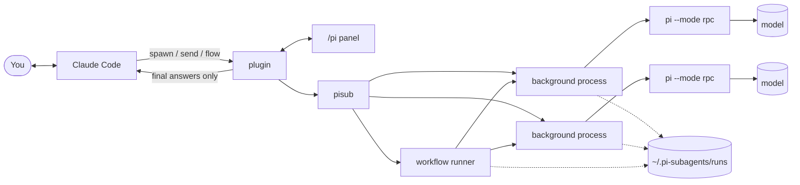

<div align="center">

# claudecode-pi-subagents-workflow

**Background sub-agents and multi-agent workflows for Claude Code that run on other models, so the grunt work doesn't eat your Claude quota.**

[](https://claude.com/claude-code)
[](https://www.anthropic.com/claude)
[](https://www.npmjs.com/package/@earendil-works/pi-coding-agent)
<br>


**English** · [简体中文](README.zh-CN.md)

</div>

> [!NOTE]
> I ([senyu132-lgtm](https://github.com/senyu132-lgtm)) made this plugin with [Claude Code](https://claude.com/claude-code) running **Claude Opus 5.5**. The design, the code, the tests and these docs were all done in Claude Code sessions.

## Why I built it

Claude Code's sub-agents and dynamic workflows are great, but on a **Claude Pro** plan they burn through the quota fast. Every sub-agent runs on the same quota as your main chat, so a workflow that fans out to ten agents can use up a whole session's worth in one go. A lot of people I know are on Pro and basically can't use these features the way they're meant to be used.

At the same time, much of that delegated work doesn't need Claude. Fixing a pile of failing tests, cleaning up a messy dataset, pulling summary numbers out of a folder of spreadsheets: a decent model with clear instructions does this fine.

So this plugin splits the work. Claude keeps the parts that need its judgment: planning, breaking the work down, design, and reviewing what comes back. The rest goes to [pi](https://www.npmjs.com/package/@earendil-works/pi-coding-agent), an open-source coding agent that can run on whatever model you have: a ChatGPT subscription, DeepSeek, OpenRouter, Gemini, a local model, and so on. I tried to make pi agents behave as close to native sub-agents as possible, so Claude uses them the same way, and a lot of what used to cost Claude quota now costs whatever your other model costs.

## What it does

- **Claude only gets the result.** Claude starts an agent with `spawn` and keeps working. When the agent finishes, Claude is told the way it is told about a finished background command, and reads the final answer from there. The notice never shows up in the conversation as if you had typed it. Everything in between (tool calls, file reads, reasoning) stays on disk, so Claude's context doesn't fill up with it and the main conversation lasts longer.
- **Workflows.** After you type `/pi flow`, Claude can write a short script that runs many agents. The script format follows Claude Code's own Workflow scripts (`agent`, `pipeline`, `parallel`, `phase`), and adds a few things: answers can be checked against a JSON Schema (the agent is asked to redo it if they don't match), `sh()` runs your own check scripts, each model gets its own concurrency limit, and a re-run reuses the results of steps that didn't change.
- **They look like native sub-agents.** In the conversation, an agent shows up the way Claude Code's own sub-agents do: `● pi(task) strong`, its latest tool calls under it while it runs, then one line such as `Done (8 tool uses · 12k tokens · 1m 12s)`. A workflow shows its phase and the agents running in it. The result message is one line per agent (ctrl+o shows the full text). This only changes what you see: Claude reads exactly the same text, so it costs no extra Claude quota.
- **You can watch and talk to them.** `/pi` (or **view** on an agent's row) opens a panel with all the agents. Click one to follow its work, drawn like the main conversation. While it runs, type into it to give it extra instructions, or switch the box to **interrupt now** to stop its current step and have it take your message at once. An agent that has given its final answer is closed.
- **Any model, mixed in one job.** Give your models short names in a config file, for example `brain` for a strong one and `worker` for a cheap one, and use both in the same workflow.
- **Edits can stay off your files.** With `isolation: 'worktree'` (`--worktree` on the CLI) an agent works in its own git worktree, on a branch of its own. You look at the diff and bring it in with `pisub apply <id>` when you're happy with it, and agents working in parallel can't overwrite each other.
- **It keeps going.** Every agent runs in its own background process, so it isn't killed when Claude Code restarts. If a provider says you've hit your usage limit, the agent can switch to another account and continue where it stopped. Rate limits and overloads are retried with increasing waits.
- **You can see what it used.** Every agent's tokens and cost, as the provider reports them, go into a monthly ledger. `pisub usage` adds them up per provider, model, alias, day or workflow, and lists the accounts that hit a usage limit.
- **Nothing hangs forever.** pi not answering, an agent going silent, a tool call that never ends, a background process that died: each has a time limit, and the agent ends with an error you are told about instead of staying "running".
- **It costs nothing when you don't use it.** Nothing starts until the first use. The tools are deferred, which means their descriptions aren't even in Claude's context until Claude looks them up.
- **pi is a good worker for this.** pi starts from a short base prompt and a small set of tools, and by default the plugin runs it without loading your CLAUDE.md or AGENTS.md. Nearly all of its context goes to the task Claude gave it.
- **English and Chinese.** The CLI, the panel and the notifications can be switched to Chinese with one setting.

### Compared with native sub-agents

| | Native Claude Code | This plugin |
|---|---|---|
| Who pays for the sub-agents | Your Claude plan | Any provider pi supports, including subscriptions you already have |
| Which models | Claude models | Any model pi can use, mixed freely in one workflow |
| Main conversation stays clean | Yes | Yes, only final answers come back |
| Scripted multi-agent workflows | Yes | Yes, same script style, plus `sh()` checks and cached re-runs |

They work fine side by side. Give the work that needs Claude-level judgment to native sub-agents and the rest to pi.

## Quick start

### 1. Install pi and sign in

You need Node.js 22.19 or newer (pi itself requires it).

```bash
npm install -g @earendil-works/pi-coding-agent
pi
```

Inside pi, type `/login`, pick a provider and follow the steps (a browser sign-in for subscriptions, or an API key). Then check that pi can see some models:

```bash
pi --list-models
```

### 2. Install the plugin

At the Claude Code prompt:

```text
/plugin install pi-subagents --marketplace senyu132-lgtm/claudecode-pi-subagents-workflow
```

Answer `y` when it asks to add the marketplace, then choose a scope (the default, user scope, makes it available in all your projects).

Or from a terminal:

```bash
claude plugin install pi-subagents --marketplace senyu132-lgtm/claudecode-pi-subagents-workflow
```

In the desktop app, click **+** next to the prompt box, then **Plugins → Add marketplace**, enter `senyu132-lgtm/claudecode-pi-subagents-workflow`, and add **pi-subagents**.

### 3. Try it

Start a new Claude Code session and ask something like:

> Use a pi sub-agent to find all the TODO comments in this repo and group them by file.

Claude starts an agent, and it shows up in the conversation like a native sub-agent, with its latest tool calls. Click **view** on that row, or type `/pi`, to watch it in detail. When it's done, Claude receives the answer and carries on.

Without a config file, pi uses its own default model (the one you last picked in pi). To give Claude several models to choose from, set up a config file as described below.

## Everyday use

**Just ask Claude.** You don't have to name tools. "Hand this to pi", "split this across a few pi agents and review what comes back", or "let a cheap model do the first pass" all work. Claude has been told to keep planning and design work for itself and to send well-defined jobs to pi.

**The `/pi` panel**
- By default it lists the agents started in this session. **Show all** also shows agents from other sessions and from the command line.
- Click an agent to see its live output in the style of the main conversation: `> prompt`, `● Bash(…)` with `⎿ output` under it, errors in red, and what it's typing right now.
- While agents of this session are running, a line above the prompt says how many; click it to open the panel.
- The box at the bottom is there while the agent runs. By default your message is passed to it after its current step (**steer**). Click the mode button to switch to **interrupt now**: the current step (a long tool call, or a wait after an overload) is stopped and the agent carries on with your message right away.
- Once an agent has given its final answer it is closed and takes no more messages. To follow up, Claude starts a new agent.
- **stop** stops it. For a workflow, the panel lists the agents by phase (the phase in progress open, finished ones folded into one line) and its log below; click an agent to open it.

**Workflows are off until you turn them on.** Type `/pi flow` in a session to allow them there, and `/pi flow off` to turn them off. This is on purpose: a workflow can start dozens of agents, so it only happens when you've said yes. The setting is remembered if you resume the session later.

**When a result looks wrong**, ask Claude to check the agent's log, or open it in the panel. The full record is always kept on disk.

## Security

Please read this before handing out real work.

- **pi agents don't ask before acting.** pi reads and writes files and runs shell commands with its own tools. Those don't go through Claude Code's permission prompts, permission rules or safety checks, so an agent can change or delete files and run commands without asking you first. Claude Code's permission settings don't apply to it.
- **Workflows run commands too.** A workflow script has no file or Node APIs of its own, but that is not a security boundary: `sh()` runs real commands on your machine, and every agent the script starts has the same tools as above. (Only the script's `meta` is read without running anything.)
- **Answers are data, not instructions.** Final answers reach Claude wrapped and labelled as sub-agent output that can't give permission for anything. That makes it harder for a file an agent read to steer Claude, but it can't rule it out, so keep an eye on what Claude does right after a result comes in.
- **What you can do about it:**
  - For jobs that only need to look (reviews, searches, analysis), use read-only mode: Claude can pass `readonly: true`, or use `--readonly` on the CLI. The agent then only gets pi's `read`, `grep`, `find` and `ls` tools, and MCP servers and project-local pi extensions are switched off. This limits tools, not files: a read-only agent can still read anything your user account can.
  - For jobs that change files, use `isolation: 'worktree'`, so the changes land on a branch you review before applying. This keeps edits off your working tree; it doesn't stop the agent from running commands.
  - Point `cwd` at the folder the job needs rather than your home folder.
  - Work in a git repository and commit before a big job, so you can see and undo what the agents changed.
  - Read workflow scripts before you let them run on anything important. Claude shows the script path when it starts one.
- **Where your data goes.** Whatever an agent reads is sent to the model provider you set up in pi. The plugin itself has no server and sends nothing anywhere else. Run logs (tasks, transcripts, tool output) are written readable by your user only on macOS and Linux (on Windows your profile folder already is), and finished runs are deleted after `keepRunsDays` days.

## Configuration

The config file is `~/.pi-subagents/config.json`. You don't need one at all; it just lets you name your models and tune a few things. Example:

```jsonc
{
  "language": "en",
  "defaultAlias": "worker",
  "aliases": {
    "brain":  { "providers": ["openai-codex", "openai-codex-2"], "model": "gpt-5.1-codex", "thinking": "high" },
    "worker": { "provider": "openrouter", "model": "deepseek/deepseek-chat", "thinking": "low" }
  },
  "flowConcurrency": { "brain": 3, "worker": 8, "default": 4 },
  "flowStaggerMs": { "worker": 1000 }
}
```

The provider and model names here are only examples. Run `pi --list-models` (or `pisub models --pi`) to see yours.

Every setting:

| Key | What it does | Default |
|---|---|---|
| `language` | `en` or `zh`, for the CLI, the panel and notifications. The `PISUB_LANG` environment variable overrides it. | `en` |
| `defaultAlias` | The alias used when Claude doesn't name a model. Empty means pi's own default model. | `""` |
| `aliases.<name>.provider` | The pi provider to use, e.g. `openrouter`. | |
| `aliases.<name>.providers` | A list of providers that serve the same model, used in order. See below. | |
| `aliases.<name>.model` | The model ID. | |
| `aliases.<name>.thinking` | Reasoning level: `off`, `minimal`, `low`, `medium`, `high`, `xhigh` or `max`. | pi's default |
| `contextFiles` | `true` lets pi read AGENTS.md / CLAUDE.md files like it normally does. | `false` |
| `exhaustedCooldownMin` | How many minutes an account is skipped after a usage-limit error that doesn't say when it resets. | `60` |
| `overloadBackoffSec` | Wait times (seconds) between retries when the service is overloaded, after pi's own retries have failed. | `[20,40,80,160,300,300]` |
| `flowConcurrency` | In workflows, how many agents of each alias may run at once. `default` covers the rest. | `{"default": 4}` |
| `flowStaggerMs` | In workflows, the minimum gap between starting two agents of the same alias. Helps with providers that dislike bursts. | `{}` |
| `maxAgents` | The most pi agents running at once on this machine, across every session and workflow. The rest wait for a free slot (shown as "waiting for a slot"). `0` turns the limit off. | `16` |
| `rpcTimeoutSec` | How long to wait for pi to answer a command before treating it as hung. | `60` |
| `stallTimeoutMin` | An agent that sends nothing for this many minutes while working (and isn't running a tool) is stopped as hung. `0` turns this off. | `20` |
| `toolTimeoutMin` | A single tool call that runs longer than this is treated as hung. `0` turns this off. | `120` |
| `keepRunsDays` | Finished runs older than this are deleted, checked once a day. Branches that hold changes are kept. `0` keeps everything. | `30` |
| `noticeFallback` | Results reach Claude as a background-command notice. If that notice can't be started (the session has no Bash or PowerShell tool, or the command was refused), `true` sends the results as a plugin message instead, labelled as not coming from you. `false` never does that: a line above the prompt says how many results are waiting and why, with a **retry** button. | `true` |

A broken `config.json` is reported as an error that names the bad setting, rather than quietly replaced by the defaults. Broken means invalid JSON, or a setting of the wrong type, such as text where a number belongs.

**Several accounts for one model (`providers`).** If you have more than one account with a provider, set each up in pi as its own provider (pi's docs on `models.json` and custom providers explain how), then list them under `providers`. When one account hits its usage limit, the agent switches to the next one and carries on. An exhausted account is skipped by every agent until it resets; `pisub accounts` shows which are resting and `pisub accounts reset` clears that.

Claude can see your aliases (the `status` tool with `models=true`), so you can just say "use brain for this one".

## Workflows

Turn them on with `/pi flow` first. After that you can ask Claude for something like "go through these 30 sales files with worker, get the monthly totals and flag odd rows, have brain double-check each report, then run my check script", and Claude will write and start a script like this one:

```js
export const meta = {
  name: 'sales-review',
  description: 'analyze each file with a cheap model, double-check with a strong one',
  phases: [{ title: 'Analyze' }, { title: 'Review' }],
}
const Verdict = { type: 'object', properties: { ok: { type: 'boolean' }, why: { type: 'string' } }, required: ['ok'] }

phase('Analyze')
const results = await pipeline(args.files,
  f => agent(`Read ${f}. Report the row count, revenue per month and any rows that look wrong. Don't edit the file.`,
             { model: 'worker', readonly: true, label: `analyze ${f}` }),
  (report, f) => agent(`Data file: ${f}\nReport:\n${report}\nRecompute the numbers from the file. Is the report right?`,
                       { model: 'brain', readonly: true, phase: 'Review', schema: Verdict, label: `review ${f}` }))

phase('Review')
const lint = await sh(['python', 'check_totals.py'])
return { results, lint: lint.stdout }
```

What's available in a script:

| | |
|---|---|
| `agent(prompt, options)` | Runs one pi agent and returns its final answer. Options: `model`, `label` (name shown in the panel), `phase`, `readonly`, `cwd`, `thinking`, `schema`, plus the ones in the next table. With `schema`, the answer must be JSON matching it; if it doesn't, the agent is asked to fix it (twice at most). Returns `null` if the agent fails or ends without an answer. |
| `pipeline(items, step1, step2, ...)` | Sends each item through the steps on its own, without waiting for the other items. Each step gets `(previous result, original item, index)`. If a step throws or returns `null`, that item ends as `null`. |
| `parallel([() => ..., ...])` | Runs everything at once and waits for all of it. Anything that throws becomes `null`. |
| `sh(command, {cwd, timeoutSec, input, cache, readonly})` | Runs a command and returns `{code, stdout, stderr}`. A string runs in bash (Git Bash on Windows); an array like `['python', 'x.py']` runs the program directly. With `cache: true`, a resumed run doesn't run it again if it succeeded last time. `readonly: true` says the command changes nothing (a check script, say), so a dry run runs it too. |
| `phase(title)`, `log(text)`, `args` | Mark the current phase, write a line to the workflow log, read the input passed in at start. |
| `meta` | Name, description and phases. Must be plain values: it's read, never run. `meta.concurrency` can override the concurrency limits, and `meta.failFast: true` ends the workflow as soon as any agent fails. |

More options for `agent()`:

| | |
|---|---|
| `isolation: 'worktree'` | Work in its own git worktree on branch `pi/<id>`, so agents editing in parallel don't overwrite each other or your files. The final summary lists each branch with changes; bring one in with `pisub apply <id>`. |
| `inputs: 'data/'` or `['a.csv', 'b.csv']` | The files or folders this agent reads. Their content becomes part of the cache key, so a resumed run redoes the agent when they change. |
| `cache: false` | Always run it, even when resuming. |
| `retries: n` | If it fails, start it again, up to n times (5 at most). A retry starts from scratch, so the task should be safe to repeat. |
| `required: true` | If this agent still fails, the whole workflow stops with an error, and so do the agents still running. |

`schema` covers most of JSON Schema 2020-12: types, `enum` and `const`, the number, string, array and object keywords, `allOf`/`anyOf`/`oneOf`/`not`, `if`/`then`/`else` and local `$ref`. A schema that uses anything else (`unevaluatedProperties`, say) is refused when `agent()` is called, rather than checked halfway.

The script runs in a background process. Claude isn't notified about each agent, only once at the end, with whatever the script returns and a summary on top: how many agents ran, which ones failed and why, which branches have changes, and how many tokens it used.

The summary also lists agents worth a second look. Each agent is compared with the others of the same phase and model, and flagged when it finished far faster, called no tool while the others did, wrote far less, or gave word for word the same answer as an agent with a different task. A text field that has the same value in nearly every answer is pointed out too. These are only hints, but they are a good place to start spot-checking a cheap model's work.

The workflow doesn't finish while an `agent()` or `sh()` it started is still running, even one the script forgot to `await`. If the script throws, the agents it still has running are stopped.

If you change the script and run it again with `resume`, every `agent()` call whose prompt and options didn't change takes its old result from the cache, and only the changed or new ones run. A cached result isn't reused when the files in its `inputs` changed or its model alias now points to a different model. If the repository changed since the old run, the summary says so, because cached results of calls without `inputs` may be out of date. `sh()` calls run again on resume unless they pass `cache: true`.

When several agents that can edit files work in the same folder at the same time, the workflow warns about it. Give them `isolation: 'worktree'`, or `readonly: true` if they only read.

**Dry run.** Before a big run, Claude can try the script with `dryRun: true` (`pisub flow run --dry-run` on the CLI). No model is called and nothing is started. Every `agent()` returns sample data made from its schema (or a placeholder text), and `sh()` runs only the commands marked `readonly: true`. The report says whether the script ran to the end, or the line where it failed. It also says how many agents a real run would start per model and phase, and how many a resume would take from the cache. And it lists problems found on the way: a model alias you don't have, a missing folder, a worktree outside a git repository, agents that could edit the same folder. A dry run gives up after 60 seconds or 5000 `agent()` calls.

## Command line

The plugin comes with a CLI, `pisub`, that does everything without Claude. It's handy for scripts and batch jobs:

```bash
pisub spawn --model worker --cwd . --task-file task.md --wait   # run an agent and print only its final answer
pisub spawn --model brain "Review src/auth.ts for bugs"          # start it and print its id right away
pisub status                                                     # list agents
pisub log <id>                                                   # what it did
pisub send <id> "also cover the edge cases"                      # add instructions to a running agent (--mode interrupt: stop its current step first)
pisub wait <id>                                                  # wait for it and print the answer
pisub stop <id>
pisub models                                                     # your aliases (--pi lists every model pi knows)
pisub accounts                                                   # accounts resting after a usage limit
pisub usage --days 30 --by alias                                 # tokens and cost (--by provider, model, alias, day or workflow)
pisub apply <id>                                                 # bring a --worktree agent's branch into your files (--check tests first)
pisub clean --days 7                                             # delete finished runs older than a week (--branches also deletes pi/<id> branches)
pisub help
```

`pisub` means `node <plugin folder>/bin/pisub.mjs`. The plugin folder is usually `~/.claude/plugins/cache/claudecode-pi-subagents-workflow/pi-subagents/<version>/`, and a shell alias saves typing. Agents started from the CLI also show up in the panel under **Show all**.

## Where things are stored

Everything lives in `~/.pi-subagents/` (set `PI_SUBAGENTS_HOME` to use another folder):

- `config.json`: your settings
- `accounts.json`: accounts currently resting after a usage limit
- `runs/<id>/`: one folder per agent or workflow, containing `state.json` (status), `task.md` (the task), `view.jsonl` (the condensed log the panel shows), `events.jsonl` (full event stream), `final.md` (final answer), `session/` (pi's own session files), and the logs `serve.log` and `pi-stderr.log`. A workflow also has `journal.jsonl` (its results, for resume); an isolated agent has its worktree in `wt/`.
- `slots/`: one small file per running agent, for the `maxAgents` limit
- `usage/<year-month>.jsonl`: the usage ledger, one line per agent and model with its tokens and cost, plus a line each time an account hit its usage limit. It isn't deleted with old runs.

Finished runs older than `keepRunsDays` (30 by default) are deleted once a day, and `pisub clean` deletes them whenever you like. Branches that hold changes are kept unless you pass `--branches`.

The plugin has no server of its own. Your code and prompts go only to the model provider you set up in pi.

## Troubleshooting

**"cannot find pi's CLI".** pi isn't installed globally, or it's somewhere the plugin doesn't look. Install it with `npm install -g @earendil-works/pi-coding-agent`, or set the `PI_CLI` environment variable to the full path of pi's `cli.js`.

**An agent fails right away.** Open it in the panel or run `pisub log <id>`. Most often the model name isn't one pi knows (check with `pisub models --pi`), or you aren't signed in to that provider. pi's own error output is in `runs/<id>/pi-stderr.log`.

**Claude never gets the result in `claude -p`.** That's expected: a non-interactive run ends with its turn, before any notification arrives. Use the CLI with `--wait` instead.

**Claude says workflows are off.** Type `/pi flow` in that session. It's a per-session switch.

**`sh()` fails on Windows.** String commands need bash, which comes with Git for Windows. If it's installed somewhere unusual, set `PISUB_BASH` to the full path of `bash.exe`. Or pass an array, `sh(['python', 'check.py'])`, which doesn't need a shell.

**An agent shows as an error after a reboot or a crash.** If its background process dies, the agent is marked as failed about 15 seconds later, with a final answer saying so, and Claude is told. If messages were still waiting for it, a new background process starts and delivers them instead. To redo the work, start a new agent; the old one's log and session stay on disk.

**An agent was stopped as hung.** pi didn't answer a command within `rpcTimeoutSec`, sent nothing for `stallTimeoutMin` minutes, or a tool call ran past `toolTimeoutMin`. If your tasks really take that long, raise those settings.

**An agent says "waiting for a slot".** `maxAgents` agents are already running on this machine. It starts as soon as one finishes.

## Limitations

- pi can't see your conversation with Claude. Every task has to say what to do, where, and in what format. Claude is instructed to write tasks that way.
- Results are only as good as the model you choose. Treat answers from cheap models as hints and have a stronger model or Claude check them before you rely on them.
- Notifications need an interactive Claude Code session (terminal or desktop app).
- A retry, or an agent continuing after its account switched, may repeat something it had already half done (a file written, a command run). It is told to check what's already done first, but that's up to the model.
- A worktree only isolates files in the repository. An isolated agent can still run commands that reach anything on your machine.
- Files matched by `.gitignore` (build output, for example) are not committed to the agent's branch; they go when its worktree is removed.
- I've mainly used it on Windows 11. macOS and Linux are handled in the code but haven't been tested as much. Issues and pull requests are welcome.

## Uninstall

```bash
claude plugin uninstall pi-subagents
```

Then delete `~/.pi-subagents/` if you don't want to keep the logs.

## Development

```bash
node --test tests/*.node-test.mjs      # workflow engine, schema validator, and broker tests against a fake pi
claude plugin test .                   # the plugin, against a simulated Claude Code
claude plugin validate .
```

To try your changes without touching your real data, point `PI_SUBAGENTS_HOME` at a scratch folder. The broker tests do that by themselves, one temporary folder per test. GitHub Actions runs the node tests on Linux, macOS and Windows.

Those tests use a fake pi. To check the whole path against a real model, run `node tests/smoke.mjs --model <alias>` (pick a cheap one). It takes about a minute: it runs an agent, interrupts a long tool call, tries a workflow dry run and a small real workflow, and checks the usage ledger. It works in a temporary `PI_SUBAGENTS_HOME` with your `config.json` and `accounts.json` copied in, so your own runs are left alone.

How the pieces fit together:



- `hooks/register.tsx`: the Claude Code side. It registers the tools, draws the panel and sends the notifications.
- `bin/pisub.mjs`: the CLI entry point (help text and command table). The rest lives in `bin/lib/`:
  - `core.mjs`: paths, settings, small file and process helpers;
  - `runs.mjs`: run folders, state, inboxes, locks and the `maxAgents` slots;
  - `models.mjs`: aliases, account pools and the usage ledger;
  - `broker.mjs`: the background process that drives `pi --mode rpc` for each agent (account switching, retries, interrupts, hang detection);
  - `flow.mjs`: `pisub flow`, the dry run and the process that runs a workflow;
  - `cli.mjs`, `git.mjs`, `maintenance.mjs`, `pi.mjs`: the agent commands, git and worktrees, `apply` and `clean`, finding pi.
- `bin/flow.mjs`: the workflow engine: runs the script in its own context (Node's `vm`, which is not a security boundary), handles concurrency, schema checks and the resume cache.
- `bin/schema.mjs`: the JSON Schema validator for `agent()` answers.
- `bin/i18n.mjs`: English/Chinese strings.
- `tests/fake-pi.mjs`: a stand-in for `pi --mode rpc` that misbehaves on request (hangs, garbage output, crashes, endless tool calls), used by `tests/broker.node-test.mjs`.

## Credits

- Made by [senyu132-lgtm](https://github.com/senyu132-lgtm) with [Claude Code](https://claude.com/claude-code) running Claude Opus 5.5.
- Built on [pi](https://www.npmjs.com/package/@earendil-works/pi-coding-agent).
- Thanks to the [LINUX DO](https://linux.do) community for the support and feedback.
- Not affiliated with Anthropic or the pi project.

## License

[MIT](LICENSE)
