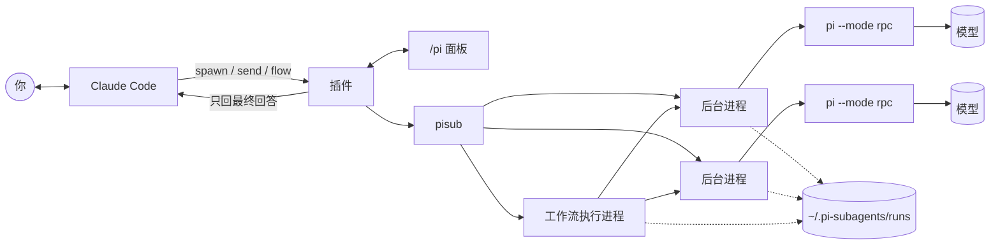

<div align="center">

# claudecode-pi-subagents-workflow

**给 Claude Code 用的后台子代理和多代理工作流，跑在别的模型上，粗活不再吃你的 Claude 额度。**

[](https://claude.com/claude-code)
[](https://www.anthropic.com/claude)
[](https://www.npmjs.com/package/@earendil-works/pi-coding-agent)
<br>


[English](README.md) · **简体中文**

</div>

> [!NOTE]
> 这个插件是我（[senyu132-lgtm](https://github.com/senyu132-lgtm)）用 [Claude Code](https://claude.com/claude-code)、模型 **Claude Opus 5.5** 做出来的。设计、写代码、测试、写文档，全程都在 Claude Code 里完成。

## 为什么做这个

Claude Code 自带的子代理和动态工作流很好用，但用 **Claude Pro** 订阅的话，额度掉得飞快。每个子代理和主对话共用一份额度，一个工作流扇出十个代理，一次就能把一整段时间的额度用光。身边不少朋友都只有 Pro，这些功能基本是用不起的。

可是交出去的活，很多其实用不着 Claude：修一堆失败的测试、清洗一份乱糟糟的数据、把一文件夹的报表汇总成几个数……说清楚要求，随便一个像样的模型都能干。

所以这个插件把活拆开：需要判断力的部分留给 Claude，比如规划、拆任务、做设计、审核结果；剩下的交给 [pi](https://www.npmjs.com/package/@earendil-works/pi-coding-agent)。pi 是一个开源的编码代理，你手上有什么模型它就能用什么：ChatGPT 订阅、DeepSeek、OpenRouter、Gemini、本地模型都行。我尽量让 pi 代理用起来和原生子代理一样，Claude 怎么用原生子代理就怎么用它们。这样一来，原本要花 Claude 额度的很多活，现在花的是别的模型的钱，甚至不花钱。

## 能做什么

- **Claude 只收结果。** Claude 用 `spawn` 派出一个代理，自己接着干别的。代理做完，Claude 收到一条消息，里面只有最终回答。中间的过程（调了哪些工具、读了哪些文件、怎么想的）都存在磁盘上，不进 Claude 的上下文，主对话能撑得更久。
- **工作流。** 你输入 `/pi flow` 之后，Claude 可以写一小段脚本，一次调度很多个代理。写法照着 Claude Code 官方的 Workflow 脚本来（`agent`、`pipeline`、`parallel`、`phase`），另外加了几样：可以要求回答符合某个 JSON Schema，不合格会让代理重交；可以用 `sh()` 跑你自己的核对脚本；每个模型单独限并发；改了脚本重跑时，没改的步骤直接用上次的结果。
- **能看、能插话。** `/pi` 打开一个面板，列出所有代理。点进去能实时看它在干什么，在输入框里打字可以给它补充要求，已经做完的也能让它接着做。
- **什么模型都行，还能混着用。** 在配置文件里给模型起个短名字，比如强模型叫 `brain`，便宜模型叫 `worker`，一个工作流里两个都能用。
- **改动可以不碰你的文件。** 加 `isolation: 'worktree'`（命令行用 `--worktree`），代理就在它自己的 git worktree、自己的分支上干活。你看过 diff、满意了再用 `pisub apply <编号>` 拿过来；几个代理同时改文件也不会互相覆盖。
- **出问题能自己扛过去。** 每个代理跑在自己的后台进程里，Claude Code 重启也不会把它带走。某个账号提示额度用完，可以自动换下一个账号接着做；遇到限流或服务过载，会隔一段时间再试，间隔越来越长。
- **不会一直卡着。** pi 不回话、代理半天没动静、某个工具调用一直不结束、后台进程死了，这些都有时间上限。到时间代理就以出错结束并通知你，不会一直显示"运行中"。
- **不用的时候不占任何东西。** 第一次用之前什么都不启动。工具是按需加载的，连工具说明都不进 Claude 的上下文，Claude 需要时才去查。
- **pi 很适合干这个。** pi 的基础提示词很短，自带的工具也不多；插件默认还不让它读你的 CLAUDE.md、AGENTS.md。它的上下文几乎全花在 Claude 交给它的那个任务上。
- **中英双语。** 命令行、面板和通知改一个设置就能切成中文。

### 和原生子代理比

| | Claude Code 原生 | 本插件 |
|---|---|---|
| 子代理花谁的钱 | 你的 Claude 订阅额度 | pi 支持的任何提供方，包括你已经有的订阅 |
| 能用哪些模型 | Claude 系列 | pi 能接的都行，一个工作流里随便混 |
| 主对话上下文不被污染 | 是 | 是，只回最终回答 |
| 用脚本编排多个代理 | 支持 | 支持，写法一样，另有 `sh()` 核对和带缓存的重跑 |

两者可以一起用：真正需要 Claude 水平的交给原生子代理，其他的交给 pi。

## 快速上手

### 1. 安装 pi 并登录

需要 Node.js 22.19 或更新的版本（pi 本身要求这个版本）。

```bash
npm install -g @earendil-works/pi-coding-agent
pi
```

在 pi 里输入 `/login`，选一个提供方，按提示登录（订阅类的会打开浏览器登录，也可以填 API key）。然后确认 pi 能看到模型：

```bash
pi --list-models
```

### 2. 安装插件

在 Claude Code 的输入框里：

```text
/plugin install pi-subagents --marketplace senyu132-lgtm/claudecode-pi-subagents-workflow
```

问要不要添加 marketplace 时输入 `y`，然后选安装范围（默认的 user 范围就行，所有项目都能用）。

也可以在终端里装：

```bash
claude plugin install pi-subagents --marketplace senyu132-lgtm/claudecode-pi-subagents-workflow
```

桌面 app：点输入框旁边的 **+**，选 **Plugins → Add marketplace**，填 `senyu132-lgtm/claudecode-pi-subagents-workflow`，再添加 **pi-subagents**。

### 3. 试一下

新开一个 Claude Code 会话，说一句：

> 派一个 pi 子代理，把这个仓库里所有的 TODO 注释找出来，按文件分组。

Claude 会派出代理，告诉你它在后台跑着。输入 `/pi` 可以看它干活。做完以后 Claude 会收到结果，接着往下做。

没有配置文件时，pi 用它自己的默认模型（也就是你在 pi 里最后选的那个）。想让 Claude 能在几个模型之间挑，看下面的"配置"。

## 日常怎么用

**直接跟 Claude 说就行**，不用提工具名。"这个交给 pi 做"、"拆成几份分给 pi，回来的结果你审一遍"、"先让便宜模型过一遍"，这些说法都可以。插件已经告诉 Claude：规划和设计自己做，目标明确的活交给 pi。

**`/pi` 面板**
- 默认只列出本会话派出的代理。点 **显示全部**，别的会话和命令行派的也会列出来。
- 点一个代理，能实时看到它的消息、工具调用、报错，以及它正在输出的内容。
- 在下面的输入框打字：代理还在跑的话，消息会在它做完当前这一步后送到；已经做完的话，它会接着原来的对话继续做，做完 Claude 会再收到结果。
- **停止** 按钮可以停掉它。如果是工作流，面板会显示当前阶段和里面的每个代理，点进去就能看那个代理。

**工作流默认是关着的。** 在某个会话里输入 `/pi flow` 才能用，`/pi flow off` 关掉。这是故意的：一个工作流可能一下子派出几十个代理，得你点头才行。之后续接这个会话，开关还保持着。

**觉得结果不对劲**，让 Claude 去看那个代理的日志，或者自己在面板里点开看。完整记录一直留在磁盘上。

## 安全须知

正式派活之前，请先看完这一节。

- **pi 代理动手前不会问你。** pi 用它自己的工具读写文件、执行命令，这些都不经过 Claude Code 的权限确认、权限规则和安全检查。也就是说，代理可以不打招呼就改文件、删文件、跑命令，Claude Code 里的权限设置对它不起作用。
- **工作流也会执行命令。** 工作流脚本本身拿不到文件和 Node 的接口，但这不是安全隔离：`sh()` 会在你的电脑上真的执行命令，脚本派出的每个代理也都有上面说的那些工具。（只有脚本里的 `meta` 是只读取、不执行的。）
- **回答是数据，不是指令。** 最终回答交给 Claude 时会包起来，并注明是子代理的输出、不能给任何授权。这样代理读到的某个文件更难反过来指挥 Claude，但没法完全杜绝，所以结果回来之后 Claude 做了什么，还是要留意。
- **怎么降低风险：**
  - 只需要看、不需要改的活（审代码、查资料、做分析），用只读模式：Claude 可以传 `readonly: true`，命令行用 `--readonly`。这样代理只有 pi 的 `read`、`grep`、`find`、`ls` 几个工具，MCP 服务和项目里的 pi 扩展也会关掉。它限制的是工具，不是文件：只读代理照样能读你这个用户能读的任何文件。
  - 要改文件的活，用 `isolation: 'worktree'`，改动先落在一个分支上，你看过再应用。这能让改动不碰你的工作区，但拦不住代理执行命令。
  - 把 `cwd` 设成这个任务真正需要的文件夹，别直接给整个用户目录。
  - 在 git 仓库里干活，大任务开始前先提交一次，代理改了什么一看就知道，也方便撤回。
  - 重要的东西，先看一眼工作流脚本再让它跑。Claude 启动工作流时会告诉你脚本存在哪。
- **数据会发到哪。** 代理读到的内容会发给你在 pi 里配的那家模型提供方。插件本身没有服务器，不会把东西发到别处。运行记录（任务、过程、工具输出）在 macOS 和 Linux 上只有你自己能读（Windows 上用户目录本来就是私有的），已结束的记录过 `keepRunsDays` 天会删掉。

## 配置

配置文件是 `~/.pi-subagents/config.json`。不建也完全能用，它只是用来给模型起名字、调几个参数。例子：

```jsonc
{
  "language": "zh",
  "defaultAlias": "worker",
  "aliases": {
    "brain":  { "providers": ["openai-codex", "openai-codex-2"], "model": "gpt-5.1-codex", "thinking": "high" },
    "worker": { "provider": "openrouter", "model": "deepseek/deepseek-chat", "thinking": "low" }
  },
  "flowConcurrency": { "brain": 3, "worker": 8, "default": 4 },
  "flowStaggerMs": { "worker": 1000 }
}
```

上面的提供方和模型名只是举例，你自己的用 `pi --list-models`（或 `pisub models --pi`）查。

全部配置项：

| 配置项 | 作用 | 默认值 |
|---|---|---|
| `language` | 命令行、面板、通知用的语言，`en` 或 `zh`。环境变量 `PISUB_LANG` 优先。 | `en` |
| `defaultAlias` | Claude 没指定模型时用哪个别名。留空就用 pi 自己的默认模型。 | `""` |
| `aliases.<名字>.provider` | 用 pi 的哪个提供方，比如 `openrouter`。 | |
| `aliases.<名字>.providers` | 提供同一个模型的多个提供方，按顺序轮换，见下文。 | |
| `aliases.<名字>.model` | 模型 ID。 | |
| `aliases.<名字>.thinking` | 思考强度：`off`、`minimal`、`low`、`medium`、`high`、`xhigh`、`max`。 | pi 的默认 |
| `contextFiles` | 设成 `true`，pi 会像平时一样读 AGENTS.md / CLAUDE.md。 | `false` |
| `exhaustedCooldownMin` | 账号报额度用完、但没说什么时候恢复时，先跳过它多少分钟。 | `60` |
| `overloadBackoffSec` | 服务过载时，pi 自己重试失败后，插件再重试的等待秒数。 | `[20,40,80,160,300,300]` |
| `flowConcurrency` | 工作流里每个别名最多同时跑几个，`default` 管其余的。 | `{"default": 4}` |
| `flowStaggerMs` | 工作流里同一个别名两次启动之间至少隔多少毫秒。有些提供方怕突发请求，用这个错开。 | `{}` |
| `maxAgents` | 这台电脑上同时运行的 pi 代理最多几个，所有会话和工作流一起算。多出来的排队等空位（显示为"排队中"）。`0` 表示不限。 | `16` |
| `rpcTimeoutSec` | 给 pi 发命令后最多等几秒，超时就当它卡死了。 | `60` |
| `stallTimeoutMin` | 代理工作中连续这么多分钟没有任何输出（又没在跑工具），就当卡死停掉。`0` 表示不检查。 | `20` |
| `toolTimeoutMin` | 单个工具调用跑超过这么多分钟，就当卡死。`0` 表示不检查。 | `120` |
| `keepRunsDays` | 已结束、超过这么多天的运行记录会被删掉，每天检查一次。有改动的分支会保留。`0` 表示全部保留。 | `30` |

`config.json` 写坏了（不是合法的 JSON）会直接报错，不会悄悄换成默认值。

**一个模型有好几个账号（`providers`）。** 如果同一家提供方你有好几个账号，先在 pi 里把每个账号分别配成一个提供方（怎么配见 pi 文档里关于 `models.json` 和自定义提供方的部分），再把它们写进 `providers`。一个账号额度用完，代理会换下一个账号，从断开的地方接着做。用完的账号所有代理都会先跳过，等它恢复；`pisub accounts` 能看哪些在休息，`pisub accounts reset` 可以清掉记录。

Claude 能看到你配的别名（`status` 工具加 `models=true`），所以你可以直接说"这个用 brain 做"。

## 工作流

先在会话里输入 `/pi flow`。然后就可以跟 Claude 说，比如"这 30 份销售数据让 worker 逐份分析，算出每月销售额、标出异常行，再让 brain 逐份复核，最后跑一下我的检查脚本"，Claude 会写一个类似这样的脚本并启动：

```js
export const meta = {
  name: 'sales-review',
  description: '便宜模型逐份分析，强模型复核',
  phases: [{ title: '分析' }, { title: '复核' }],
}
const Verdict = { type: 'object', properties: { ok: { type: 'boolean' }, why: { type: 'string' } }, required: ['ok'] }

phase('分析')
const results = await pipeline(args.files,
  f => agent(`读 ${f}，报告行数、每月销售额和看起来有问题的行。不要改文件。`,
             { model: 'worker', readonly: true, label: `分析 ${f}` }),
  (report, f) => agent(`数据文件：${f}\n分析报告：\n${report}\n按文件重新算一遍，报告对不对？`,
                       { model: 'brain', readonly: true, phase: '复核', schema: Verdict, label: `复核 ${f}` }))

phase('复核')
const lint = await sh(['python', 'check_totals.py'])
return { results, lint: lint.stdout }
```

脚本里能用的东西：

| | |
|---|---|
| `agent(提示词, 选项)` | 跑一个 pi 代理，返回它的最终回答。选项有 `model`、`label`（面板里显示的名字）、`phase`、`readonly`、`cwd`、`thinking`、`schema`，还有下一张表里的几个。给了 `schema` 的话，回答必须是符合它的 JSON，不符合会让代理改，最多改两次。代理失败或者结束了却没给回答，返回 `null`。 |
| `pipeline(列表, 步骤1, 步骤2, ...)` | 每一项各走各的，依次经过这些步骤，不用等别的项。每个步骤拿到 `(上一步的结果, 原始项, 序号)`。某一步出错或返回 `null`，这一项最后就是 `null`。 |
| `parallel([() => ..., ...])` | 全部同时跑，等全部跑完再返回。出错的那一项变成 `null`。 |
| `sh(命令, {cwd, timeoutSec, input, cache})` | 跑一个命令，返回 `{code, stdout, stderr}`。传字符串用 bash 跑（Windows 上是 Git Bash）；传数组，比如 `['python', 'x.py']`，就直接运行那个程序。加 `cache: true` 的话，续跑时上次成功过的就不再执行。 |
| `phase(标题)`、`log(文字)`、`args` | 标记当前阶段、往工作流日志里写一行、读取启动时传进来的参数。 |
| `meta` | 名字、说明、阶段列表，只能写固定的值：它只被读取，从不执行。`meta.concurrency` 可以覆盖并发设置，`meta.failFast: true` 表示任何一个代理失败，整个工作流就停。 |

`agent()` 的其他选项：

| | |
|---|---|
| `isolation: 'worktree'` | 在它自己的 git worktree 里干活，分支是 `pi/<编号>`，几个代理同时改文件不会互相覆盖，也不碰你的文件。最后的汇总会列出每个有改动的分支，用 `pisub apply <编号>` 拿过来。 |
| `inputs: 'data/'` 或 `['a.csv', 'b.csv']` | 这个代理要读的文件或文件夹。它们的内容会算进缓存的键里，内容变了，续跑时这个代理就重做。 |
| `cache: false` | 每次都真的跑，续跑时也不用缓存。 |
| `retries: n` | 失败了就重新派，最多 n 次（上限 5）。重试是从头做，所以任务要经得起重复做。 |
| `required: true` | 这个代理重试完还是失败，整个工作流就以出错结束，还在跑的代理也一起停掉。 |

`schema` 支持 JSON Schema 2020-12 的大部分：类型、`enum` 和 `const`、数字/字符串/数组/对象的各项约束、`allOf`/`anyOf`/`oneOf`/`not`、`if`/`then`/`else`，以及指向本文档内的 `$ref`。用到别的关键字（比如 `unevaluatedProperties`）的 schema，在调用 `agent()` 时就会被拒绝，不会只校验一半。

脚本在后台进程里跑。Claude 不会每个代理都收到一次通知，只在最后收到一次，内容是脚本的返回值，前面附一段汇总：跑了几个代理、哪些失败了、为什么失败、哪些分支有改动。脚本派出的 `agent()` 和 `sh()` 只要还有一个没结束，工作流就不会结束，哪怕脚本忘了写 `await`。脚本出错退出时，它还在跑的代理会被停掉。

改了脚本再用 `resume` 重跑时，提示词和选项都没变的 `agent()` 直接用上次的结果，只有改过的和新加的会真的去跑。`inputs` 里的文件变了，或者模型别名现在指向了别的模型，这条缓存就不用。仓库在上次运行之后有变动的话，汇总里会提醒，因为没写 `inputs` 的调用用的缓存可能已经过时。`sh()` 续跑时都会重新执行，除非加了 `cache: true`。

好几个能改文件的代理同时在同一个文件夹里干活时，工作流会提醒你。给它们加 `isolation: 'worktree'`，只读的就加 `readonly: true`。

## 命令行

插件带了一个命令行工具 `pisub`，不经过 Claude 也能做所有事，写脚本、跑批量任务时很方便：

```bash
pisub spawn --model worker --cwd . --task-file task.md --wait   # 跑一个代理，只输出最终回答
pisub spawn --model brain "检查 src/auth.ts 里的 bug"             # 派出去，马上返回编号
pisub status                                                     # 列出代理
pisub log <id>                                                   # 看它做了什么
pisub send <id> "边界情况也覆盖一下"                              # 补充要求，或者让做完的接着做
pisub wait <id>                                                  # 等它做完，输出回答
pisub stop <id>
pisub models                                                     # 你配的别名（加 --pi 列出 pi 认识的所有模型）
pisub accounts                                                   # 哪些账号因为额度用完在休息
pisub apply <id>                                                 # 把 --worktree 代理的分支应用到你的文件（--check 先检查）
pisub clean --days 7                                             # 删掉一周以前已结束的运行记录（--branches 连 pi/<id> 分支一起删）
pisub help
```

这里的 `pisub` 指 `node <插件目录>/bin/pisub.mjs`。插件目录一般在 `~/.claude/plugins/cache/claudecode-pi-subagents-workflow/pi-subagents/<版本号>/`，可以设个 shell 别名省点事。命令行派的代理在面板的 **显示全部** 里也能看到。

## 数据存在哪

全部在 `~/.pi-subagents/` 下面（设环境变量 `PI_SUBAGENTS_HOME` 可以换地方）：

- `config.json`：你的配置
- `accounts.json`：因为额度用完正在休息的账号
- `runs/<id>/`：每个代理或工作流一个文件夹，里面有 `state.json`（状态）、`task.md`（任务）、`view.jsonl`（面板显示的精简日志）、`events.jsonl`（完整事件）、`final.md`（最终回答）、`session/`（pi 自己的会话文件），还有日志 `serve.log` 和 `pi-stderr.log`。工作流另有 `journal.jsonl`（各步结果，续跑用）；隔离的代理在 `wt/` 里放它的 worktree。
- `slots/`：每个正在运行的代理一个小文件，用来执行 `maxAgents` 的上限

已结束、超过 `keepRunsDays` 天（默认 30 天）的记录每天自动清一次，`pisub clean` 随时可以手动清。有改动的分支默认保留，加 `--branches` 才一起删。

插件没有自己的服务器。你的代码和提示词只会发给你在 pi 里配的那家模型提供方。

## 常见问题

**提示"找不到 pi 的 CLI"。** pi 没有全局安装，或者装在插件找不到的地方。用 `npm install -g @earendil-works/pi-coding-agent` 安装，或者把环境变量 `PI_CLI` 设成 pi 的 `cli.js` 的完整路径。

**代理一启动就出错。** 在面板里点开看，或者运行 `pisub log <id>`。最常见的原因是模型名 pi 不认识（用 `pisub models --pi` 查），或者那家提供方你还没登录。pi 自己的报错在 `runs/<id>/pi-stderr.log` 里。

**用 `claude -p` 时 Claude 收不到结果。** 这是正常的：非交互模式一轮结束就退出了，等不到通知。这种场合改用命令行加 `--wait`。

**Claude 说工作流没开启。** 在那个会话里输入 `/pi flow`。开关是每个会话单独的。

**Windows 上 `sh()` 跑不起来。** 传字符串的命令要用 bash，装了 Git for Windows 就有。如果装在不常见的位置，把环境变量 `PISUB_BASH` 设成 `bash.exe` 的完整路径。也可以传数组，比如 `sh(['python', 'check.py'])`，这样不需要 shell。

**重启电脑或崩溃之后，代理显示出错。** 后台进程死掉后大约 15 秒，代理会被标成出错，最终回答里写明原因，Claude 也会收到通知。如果还有消息没送到它那里，会改为重新起一个后台进程把消息送过去。给它发一条消息，它会从保存的会话接着做。

**代理被当成卡死停掉了。** pi 在 `rpcTimeoutSec` 秒内没回应命令，或者连续 `stallTimeoutMin` 分钟没有任何输出，或者某个工具调用跑过了 `toolTimeoutMin`。如果你的任务确实要这么久，把这几个设置调大。

**代理显示"排队中"。** 这台电脑上已经有 `maxAgents` 个代理在跑，等有一个结束它就开始。

## 局限

- pi 看不到你和 Claude 的对话。每个任务都得写清楚做什么、在哪做、交什么格式。插件已经要求 Claude 这样写任务。
- 结果好不好取决于你选的模型。便宜模型的结论只能当线索，真要用之前让强模型或 Claude 复核一遍。
- 通知只在交互式的 Claude Code 会话里有（终端或桌面 app）。
- 重试，或者换账号后接着做，可能会把已经做了一半的事再做一遍（比如又写一次文件、又跑一次命令）。插件会让它先检查哪些已经做完，但做不做得到看模型。
- worktree 只隔离仓库里的文件。隔离的代理照样能执行命令，碰到你电脑上的任何东西。
- 我主要在 Windows 11 上用。代码里也处理了 macOS 和 Linux，但测得少。欢迎提 issue 和 PR。

## 卸载

```bash
claude plugin uninstall pi-subagents
```

不想留日志的话，再把 `~/.pi-subagents/` 删掉。

## 开发

```bash
node --test tests/*.node-test.mjs      # 工作流引擎、Schema 校验器，以及用假 pi 跑的 broker 测试
claude plugin test .                   # 插件本身（在模拟的 Claude Code 上跑）
claude plugin validate .
```

想试改动又不想碰真实数据，把 `PI_SUBAGENTS_HOME` 指到一个临时文件夹。broker 测试会自己这么做，每个测试一个临时文件夹。GitHub Actions 会在 Linux、macOS 和 Windows 上跑这些 node 测试。

各部分怎么配合：



- `hooks/register.tsx`：Claude Code 这一侧，负责注册工具、画面板、发通知。
- `bin/pisub.mjs`：命令行，以及给每个代理驱动 `pi --mode rpc` 的后台进程，换账号和重试也在这里。
- `bin/flow.mjs`：工作流引擎：在单独的上下文里跑脚本（用的是 Node 的 `vm`，不是安全隔离），管并发、Schema 校验和重跑缓存。
- `bin/schema.mjs`：校验 `agent()` 回答的 JSON Schema 校验器。
- `bin/i18n.mjs`：中英文文本。
- `tests/fake-pi.mjs`：假的 `pi --mode rpc`，可以按要求出各种毛病（卡住、输出乱码、崩溃、工具调用不结束），给 `tests/broker.node-test.mjs` 用。

## 致谢

- 由 [senyu132-lgtm](https://github.com/senyu132-lgtm) 用 [Claude Code](https://claude.com/claude-code)（模型 Claude Opus 5.5）制作。
- 基于 [pi](https://www.npmjs.com/package/@earendil-works/pi-coding-agent)。
- 和 Anthropic、pi 项目都没有关系。

## 许可证

[MIT](LICENSE)
